<p align="center">
  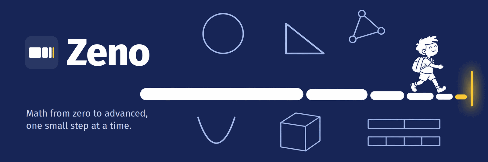
</p>

<p align="center">
  <b>Free, open-source math practice and whiteboards for schools and universities: one system from counting to a degree.</b><br>
  <a href="https://davidtbilisi.github.io/zeno-math/">Website</a> ·
  <a href="https://davidtbilisi.github.io/zeno-math/practice/">Try the practice</a> ·
  <a href="https://davidtbilisi.github.io/zeno-math/learn/">Topics</a> ·
  <a href="docs/features.md">Every feature</a> ·
  <a href="#run-with-docker">Self-host</a>
</p>

<p align="center">
  
  
  
</p>

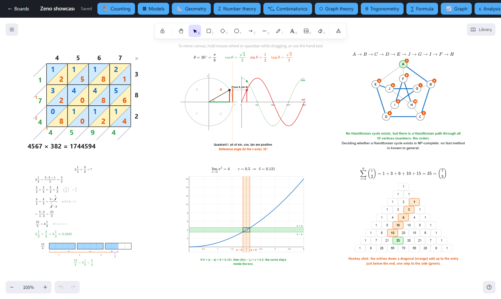

Zeno's paradox says you need infinitely many small steps to cross a room, and yet you get there. Zeno is one maths
system for a school or a university: practice that names the mistake a student made, a teacher's page that shows who
is stuck and on what, topics and goal roadmaps from first steps to a degree, and an infinite whiteboard where every
picture is a live object you can change. It works just as well for learning on your own.

## See it work

<table>
<tr>
<td width="50%" valign="top">
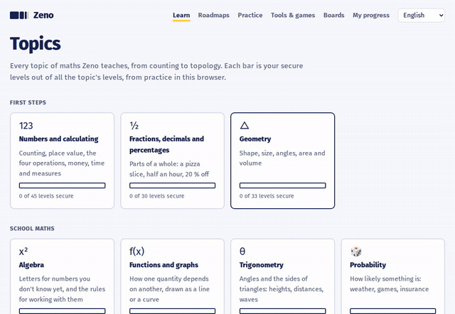<br>
<b>A maths site first.</b> Pick a topic and work through its lessons right on the page; open any of them on a
board when you want to keep it.
</td>
<td width="50%" valign="top">
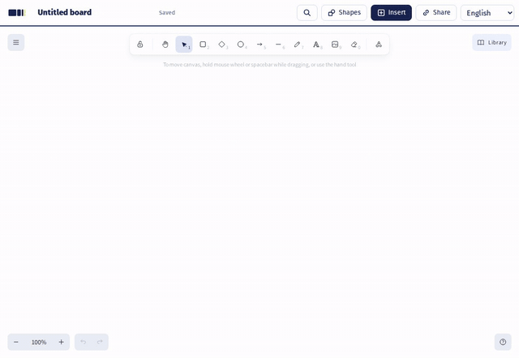<br>
<b>One Insert button.</b> On a board, the whole library is one panel: browse by group or search, and the piece
lands in the middle of the board.
</td>
</tr>
<tr>
<td width="50%" valign="top">
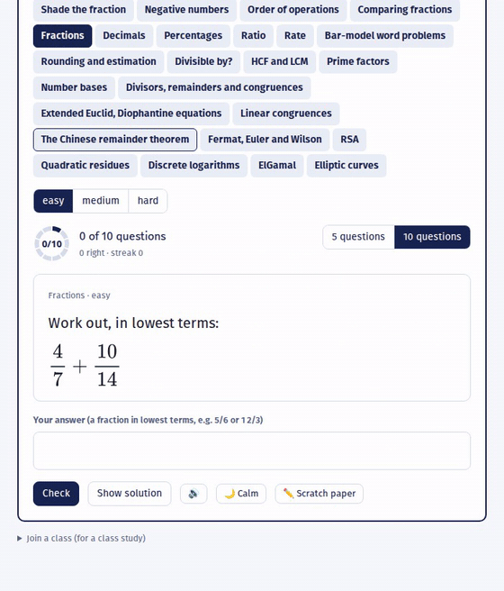<br>
<b>Practice that knows the mistake.</b> Add the tops and the bottoms, and Zeno says that is what you did, then
walks you through it one step at a time.
</td>
<td width="50%" valign="top">
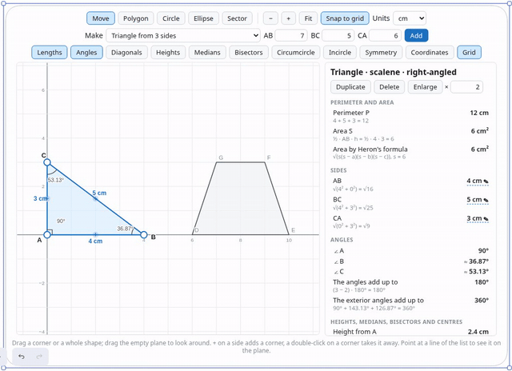<br>
<b>Geometry you can grab.</b> Drag a corner and every length, angle and area follows; one click adds the
circumcircle.
</td>
</tr>
<tr>
<td valign="top">
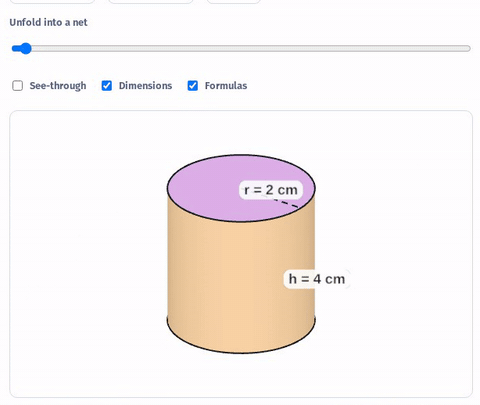<br>
<b>3D solids that unfold.</b> Turn a cylinder or a cone and slide it open into its net, with the volume and
surface area beside it.
</td>
<td valign="top">
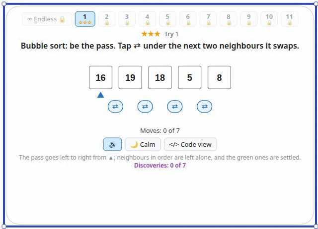<br>
<b>Be the algorithm.</b> In <i>Be the sort</i> you make every swap bubble sort makes (then insertion, selection, merge, quick); there are games for
search, DP, heaps, graphs and system design too.
</td>
</tr>
<tr>
<td valign="top">
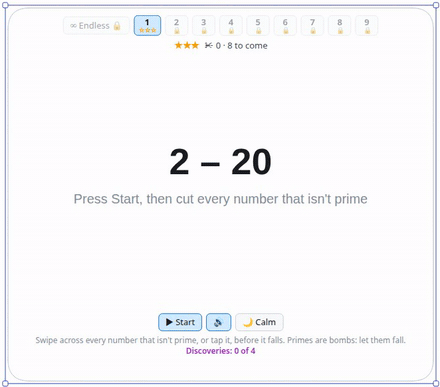<br>
<b>Games with levels.</b> <i>Prime slice</i>: cut every number that isn't prime before it falls. Pass with two
stars, climb the ladder, beat the clock.
</td>
<td valign="top">
<b>What's on the board</b><br><br>
Bar models, place value, fractions and percentages · algebra tiles and equations · geometry, trigonometry and
3D · graph theory, combinatorics and number theory · calculus, ODEs and linear algebra · probability and
statistics · algorithms and data structures · maths for AI · a whole maths degree, course by course.
<br><br>
<a href="docs/features.md">The full list →</a>
</td>
</tr>
</table>

## More pictures

Every picture is generated and stays editable: double-click it to change the numbers.

<table>
<tr>
<td align="center">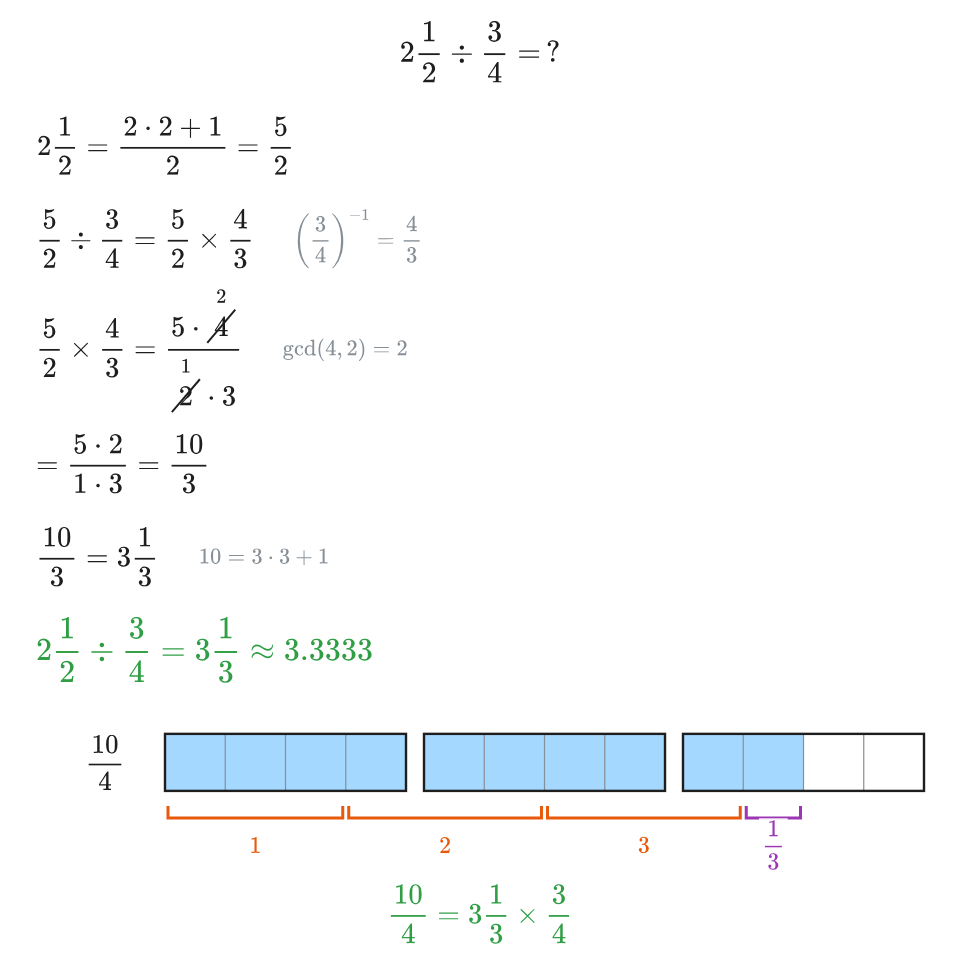<br><sub>Fraction division</sub></td>
<td align="center">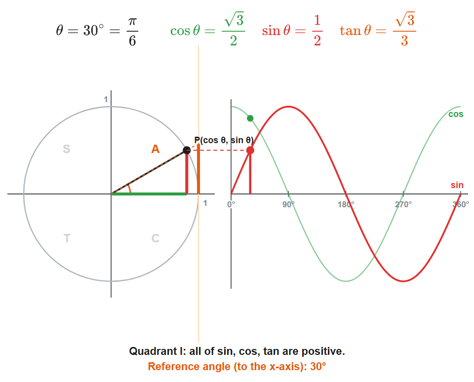<br><sub>Unit circle and sine</sub></td>
<td align="center">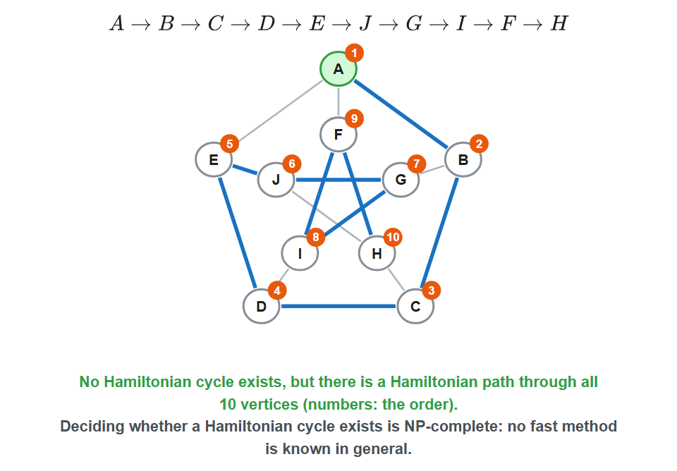<br><sub>Petersen graph</sub></td>
</tr>
<tr>
<td align="center">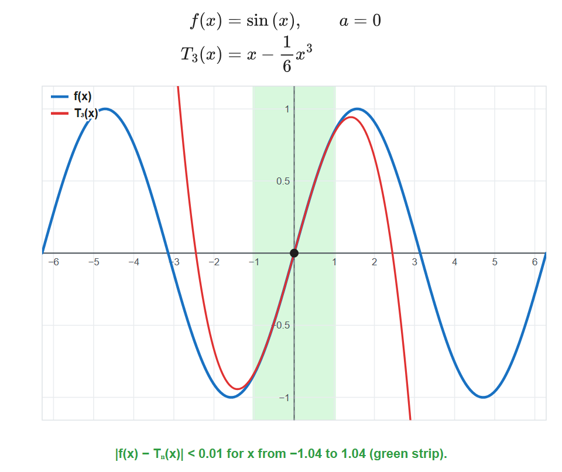<br><sub>Taylor polynomials</sub></td>
<td align="center">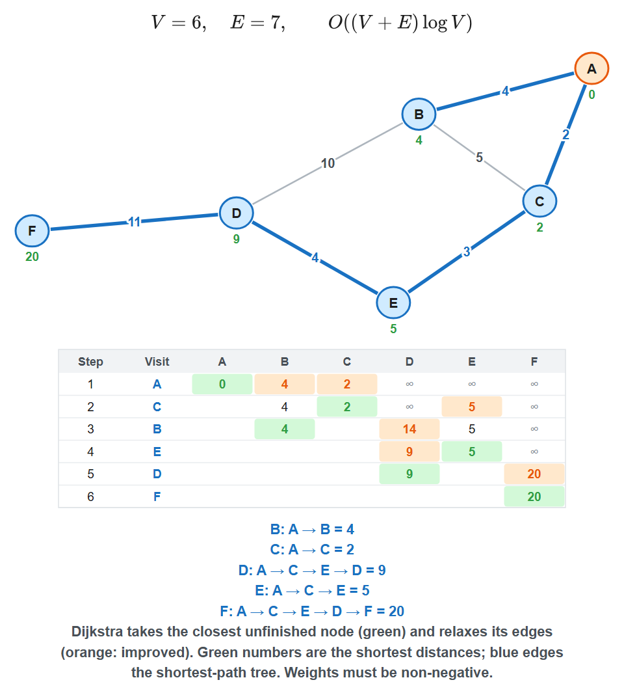<br><sub>Dijkstra's algorithm</sub></td>
<td align="center">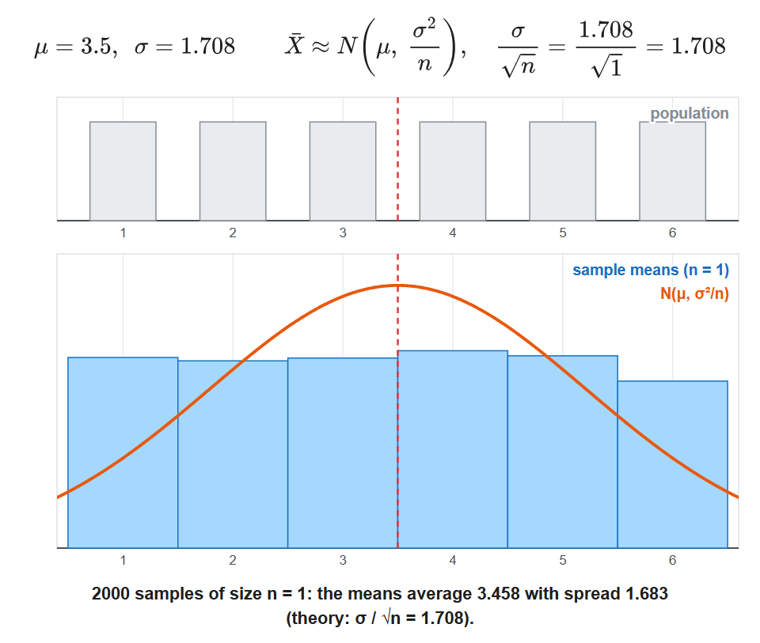<br><sub>Central limit theorem</sub></td>
</tr>
</table>

[All screenshots →](docs/features.md#screenshots)

## For classes

A teacher makes a class at `#/teacher`; students make an account, join with the class code, practise on their own
level on any device, and the teacher sees who is stuck and why. Zeno can also run a study that compares adaptive practice with a
fixed sequence, with pre-, post- and delayed tests. See [docs/study.md](docs/study.md).

[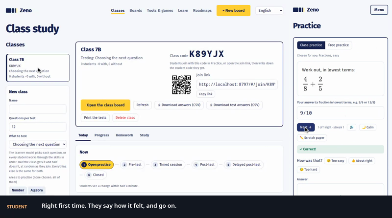](docs/teacher-guide.md)

Six short videos show it step by step: making a class, students joining, running a lesson, homework, progress and
tests on paper. [The teacher's guide →](docs/teacher-guide.md)

## Run with Docker

```bash
docker compose up -d --build        # then open http://localhost:8787
```

On a network, set a password: `APP_PASSWORD=… TEACHER_PASSWORD=… docker compose up -d --build`.
HTTPS, backups and every setting are in [docs/self-hosting.md](docs/self-hosting.md).

Without Docker (Node.js ≥ 23.6):

```bash
npm install && npm run build && npm start   # http://localhost:8787
npm run dev                                 # hot reload on :5173
```

## Docs

| | |
|---|---|
| [Features](docs/features.md) | everything Zeno can draw, check and play |
| [Teacher's guide](docs/teacher-guide.md) | videos: classes, joining, lessons, homework, progress, paper tests |
| [Self-hosting](docs/self-hosting.md) | Docker, passwords, HTTPS, backups, the class study |
| [Development](docs/development.md) | tests, project layout, ideas for later |
| [Architecture](docs/architecture.md) · [API](docs/api.md) · [The code, explained](docs/code-explanation.md) | how it is built |
| [Study](docs/study.md) | the research side |

The GIFs above are recorded by `scripts/readme-media.mjs` against a running build, the teacher videos by
`scripts/workflow-videos.mjs`.

## License

Copyright © 2026 David Chincharashvili. Free software under the
[GNU Affero General Public License v3.0 or later](LICENSE). If you run a modified Zeno for other people over a
network, offer them your source: point `SOURCE_URL` in `src/components/SiteBar.tsx` at your copy. Versions up to the tag
`mit-final` stay MIT. Bundled libraries keep their own licenses (Excalidraw, React and three.js MIT; MathJax and
math.js Apache-2.0).
