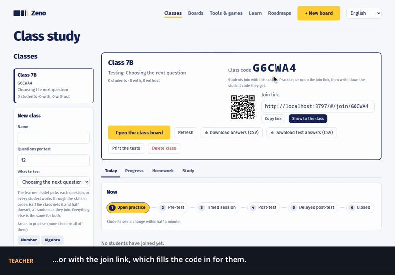
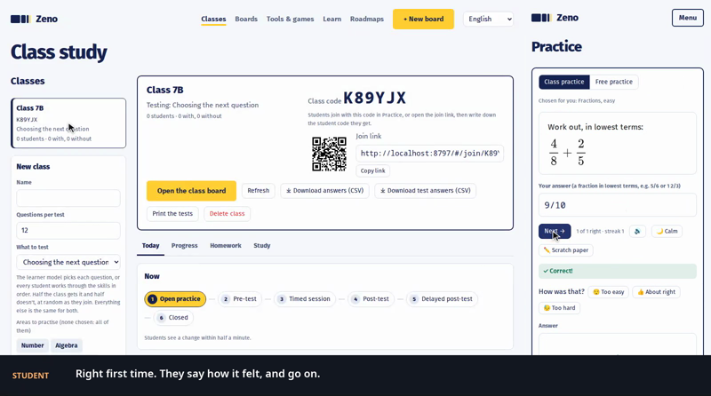
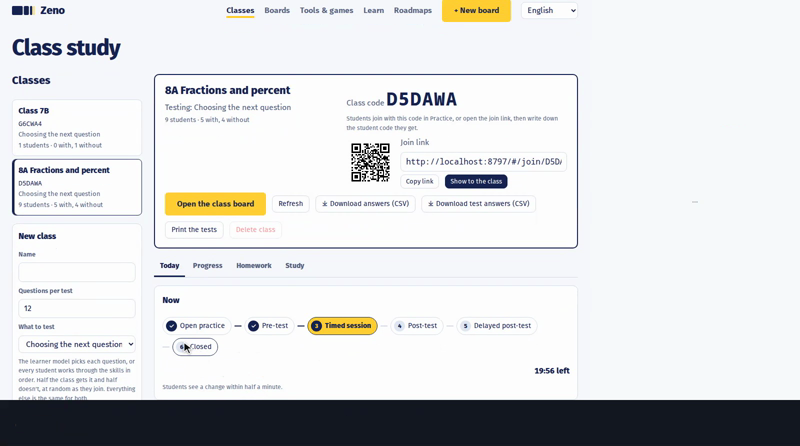
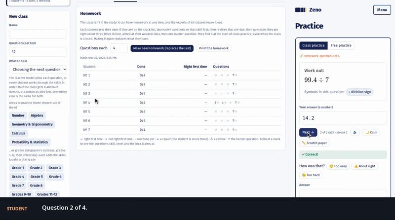
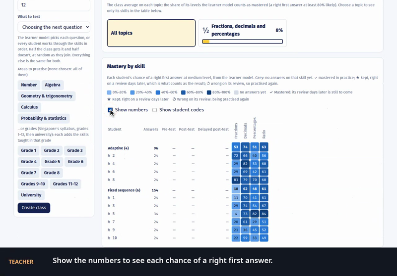
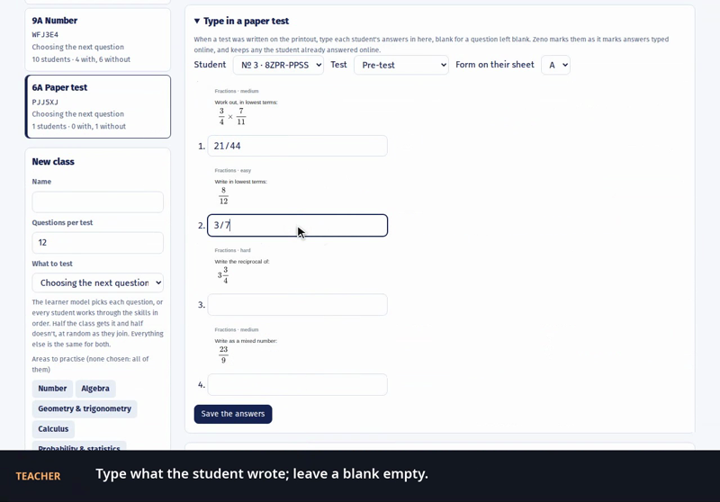

# Zeno for teachers, in six short videos

Each video shows one job from start to finish, with a caption for every step. Videos with a student in them show
the teacher's laptop on the left and the student's phone on the right. Click a picture to play its video.

## 1. Make a class

Open `#/teacher`, type the teacher password, name the class and choose what it practises: whole topics, or every
skill of a grade. The class gets a code, a join link and a QR code to show to the room.

[](media/workflows/class.mp4)

## 2. Students join

A student opens the join link or scans the QR code. They make an account (their name, an email and a password), or
sign in to the one they have. The class code is already filled in; they agree to take part and press Join, and their
first question comes straight away. From then on signing in on any device brings their record back. After **Refresh**
the teacher sees them in the class and in the mastery table, by name.

[](media/workflows/join.mp4)

## 3. Run a lesson

The **Today** tab moves the class through the lesson: open practice, the pre-test, a timed session, the post-test,
the delayed post-test, closed. A test reaches every student's practice within half a minute. Below it, **Who is
stuck** groups the students who keep making the same mistake. Mark one **Seen** once you have helped them.

[](media/workflows/lesson.mp4)

## 4. Give homework

On the **Homework** tab, **Make homework for every student** gives each student their own questions, chosen from
their own answers: easier repair questions for a student on the stuck list, reviews that are due, practice aimed at
their weakest idea, and one harder question. The student finds it when they open practice. The table fills in as
they answer, and **Print the homework** gives a sheet for each student without a device at home.

Homework opens once the class has taken its delayed post-test, so it can't change what the study compares. A class
that isn't part of the study, a pilot say, can be taken out of it on the same tab, and then has homework at any time.

Under the homework, **Games** assigns games from the Games menu, any with a ladder of puzzles. They open when homework
does. Each student's site lists them under "Games from your teacher", and their stars come back to a table with a
column per game: ✓ once every puzzle has two stars or more, else the stars won so far. **Take the games off** clears
the list. A class that has had games assigned can't go back into the study.

[](media/workflows/homework.mp4)

## 5. Read the class's progress

The **Progress** tab gives the class a goal (a roadmap each student's site opens on), each topic's class average, and
the mastery table: a row per student, a column per skill, each cell the chance of a right first answer. **Find a
student's code** finds the code of a student who lost theirs, by their number in the class list.

[](media/workflows/progress.mp4)

## 6. Tests on paper

**Print the tests** gives the three test forms, each with its answer key. After a test written on paper, type each
sheet in on the **Study** tab: Zeno marks it as it marks answers typed online.

[](media/workflows/paper.mp4)

## Recording them again

The videos are recorded by `scripts/workflow-videos.mjs` against a running build, on an empty data folder (each
scene adds its classes and students through the API):

```bash
npm run build
PORT=8797 DATA_DIR=$(mktemp -d) TEACHER_PASSWORD=demo APP_PASSWORD= node server/index.ts &
npm run workflow-videos              # or name scenes: class join lesson homework progress paper
```

It needs `ffmpeg` with an H.264 encoder (libx264, or OpenH264 as in Fedora's ffmpeg-free) and the `drawtext`
filter, which writes the captions in a strip under the picture.
