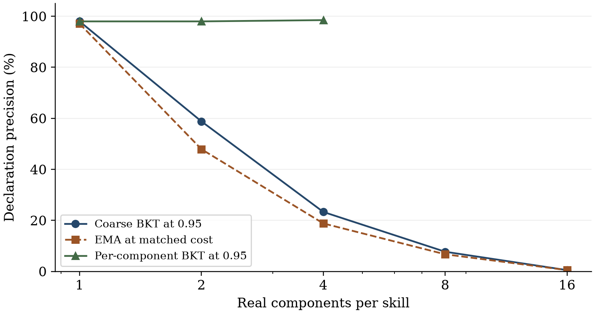
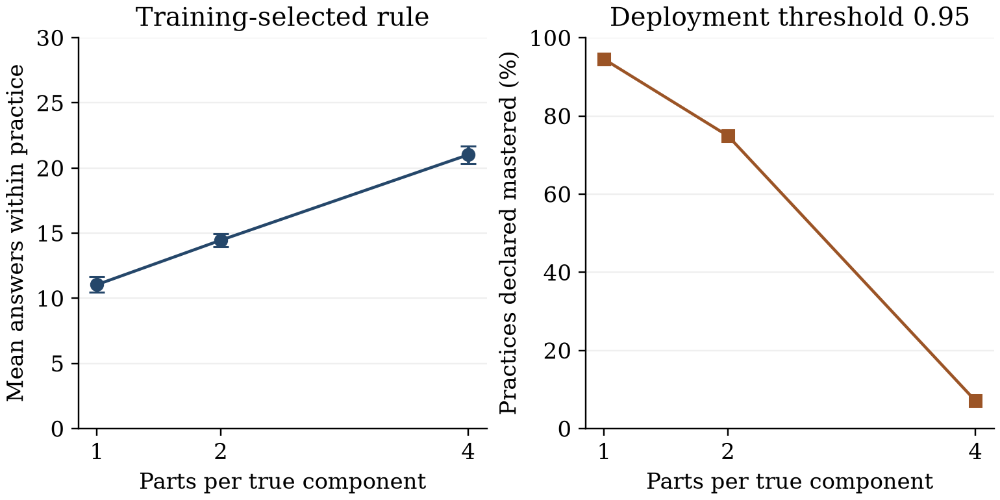

```{=latex}
\begin{titlepage}
\thispagestyle{empty}
\centering
\vspace*{1cm}
\includegraphics[width=3.5cm]{docs/thesis/figures/ug-logo.jpeg}\par
\vspace{1.2cm}
{\LARGE The Effect of Skill Granularity on Mastery Estimation in Adaptive Learning Systems\par}
\vspace{0.6cm}
{\large Preliminary Thesis Draft\par}
\vspace{1.8cm}
Author:\par
Davit Tchintcharashvili\par
\vspace{1.5cm}
School of IT, Engineering and Mathematics\par
University of Georgia\par
\vspace{1.5cm}
This is approved by\par
Supervisor:\par
Mikheil Gigauri\par
\vfill
8 November 2026\par
\end{titlepage}
```

::: {.docx custom-style="Title Page"}
{width=3.3cm}
:::

::: {.docx custom-style="Title"}
The Effect of Skill Granularity on Mastery Estimation in Adaptive Learning Systems
:::

::: {.docx custom-style="Title Page"}
Preliminary Thesis Draft

&nbsp;

Author: Davit Tchintcharashvili

&nbsp;

School of IT, Engineering and Mathematics

University of Georgia

&nbsp;

This is approved by

Supervisor: Mikheil Gigauri

&nbsp;

8 November 2026
:::

```{=openxml}
<w:p><w:r><w:br w:type="page"/></w:r></w:p>
```

# რეზიუმე

ნაშრომი იკვლევს, როგორ მოქმედებს უნარების დეტალიზაციის დონე ადაპტურ სასწავლო სისტემებში ათვისების შეფასების სიზუსტესა და საიმედოობაზე. დეტალიზაციის დონე გულისხმობს თემის ცოდნის კომპონენტებად დაყოფასა და კითხვების ამ კომპონენტებთან დაკავშირებას. შედარებულია ბაიესური ცოდნის მიდევნება (BKT), პასუხების ექსპონენციალური მოძრავი საშუალო (EMA) და ზედიზედ სწორი პასუხების წესი.

წინასწარი ნაშრომი წარმოადგენს მეთოდსა და სიმულაციის ძირითად შედეგებს. სიმულაციებში მოსწავლის ნამდვილი ცოდნის მდგომარეობა ცნობილია, რაც ათვისების შესახებ გადაწყვეტილებების შემოწმების საშუალებას იძლევა. მოდელი გამოიყენება რეალურ სასწავლო ერთეულებზე უფრო მსხვილ, შესაბამის და უფრო წვრილ დონეებზე. პარამეტრები და ზღურბლები ირჩევა სასწავლო შერჩევაზე, ხოლო შეფასება ტარდება ცალკე გამოყოფილ მოსწავლეებზე. იზომება სწორი გადაწყვეტილებების წილი, პრაქტიკის ხარჯი, ათვისებულად გამოცხადებული შემთხვევების წილი და კალიბრაცია.

BKT უკეთ მუშაობს, როცა სწავლა მის დაშვებებს უახლოვდება. თანდათანობითი სწავლისას მისი ცოდნის ალბათობა ცუდად კალიბრირდება და მისაღები სიზუსტისთვის შეიძლება საჭირო გახდეს ერთთან უკიდურესად ახლოს მყოფი ზღურბლი. რამდენიმე კომპონენტის ერთ უნარად მოდელირება ამცირებს გადაწყვეტილებების სიზუსტეს. კომპონენტების ცალ-ცალკე მოდელირება სასარგებლოა, როცა კითხვები მათ განასხვავებს და პრაქტიკა საკმარის მტკიცებულებას იძლევა. ზედმეტად წვრილი დაყოფა ზრდის ხარჯს და ამცირებს ათვისების გამოცხადების სიხშირეს. სასწავლო შერჩევაზე შერჩეული ზღურბლი სხვა მოსწავლეებზე იმავე სიზუსტეს ყოველთვის ვერ ინარჩუნებს.

წინასწარი დასკვნაა, რომ კომპონენტების დაყოფა, კითხვების აგებულება და ათვისების წესი ერთად უნდა შეფასდეს. შედეგები არ ადგენს ყველა მოსწავლისთვის საუკეთესო დეტალიზაციის დონეს და არ ზომავს ზენოს გავლენას საკლასო სწავლებაზე. რეალურ ASSISTments მონაცემებზე ანალიზი საბოლოო ნაშრომში იქნება წარმოდგენილი.

```{=latex}
\clearpage
```
```{=openxml}
<w:p><w:r><w:br w:type="page"/></w:r></w:p>
```

# Abstract

This thesis asks how skill granularity affects the accuracy and reliability of mastery estimation in adaptive learning systems. Granularity means the division of a topic into knowledge components and the mapping from questions to those components. The methods compared are Bayesian Knowledge Tracing (BKT), an exponential moving average of answers (EMA), and a consecutive-correct rule.

This preliminary draft presents the method and the main simulation results. The simulations record the learner's true knowledge state, allowing mastery declarations to be checked directly. The model is applied at grains coarser than the real learning units, at the matching grain, and at finer grains. Parameters and thresholds are selected on training students and evaluated on separate held-out students. The measures cover declaration precision, practice cost, declaration coverage and calibration.

BKT works better where learning resembles its assumptions. Under gradual learning, its knowledge probability becomes poorly calibrated, and acceptable precision can require a threshold extremely close to one. Modelling several components as one skill lowers declaration precision. Tracing components separately helps where questions distinguish them and practice supplies enough evidence. Excessively fine modelling increases cost and reduces declaration coverage. A threshold selected on training students does not always retain its precision on other students.

The preliminary conclusion is that the component mapping, question design and mastery rule must be evaluated together. The results do not identify a universally optimal grain or measure Zeno's effect on classroom learning. The real-data ASSISTments analysis is reserved for the final thesis.

```{=latex}
\clearpage
\tableofcontents
\clearpage
```
```{=openxml}
<w:p><w:r><w:br w:type="page"/></w:r></w:p>
```

<!-- docx-contents -->

```{=openxml}
<w:p><w:r><w:br w:type="page"/></w:r></w:p>
```

# Introduction

A mathematics practice system must decide when a student knows a skill well enough to move on. If it stops too early,
the student starts work that depends on something they have not learnt. If it stops too late, it spends time on
questions the student can already answer. The decision depends both on the rule used and on what the system calls
one skill. Fractions can be one skill, or a collection of ideas which a student may know separately. A probability
that a student knows “fractions” has a different meaning under those two descriptions.

This thesis asks: how does the level of skill granularity affect the accuracy and reliability of mastery estimation
in adaptive learning systems? Grain means the number of knowledge components a topic is divided into together with
the mapping from questions to those components. Accuracy is the share of mastery declarations that are correct when
the learner's true state is known, or prediction quality when it is not. Reliability concerns calibration, the
stability of the threshold needed for a trustworthy decision, and whether decisions survive a change of grain.

The methods compared are Bayesian Knowledge Tracing (BKT), an exponential moving average (EMA) and the rule that
requires a run of right answers. The work grew out of Zeno, a mathematics whiteboard and practice system for Georgian
classrooms. Zeno supplies the implementation and, in one simulated world, the question generators. This is a study of
mastery estimation rather than an evaluation of whether using Zeno improves classroom learning.

This preliminary draft gives the method and the main simulation results. It first compares the methods at one grain,
then makes the model too coarse, matches it to the learner's components, and makes it too fine. The simulations record
the true state after every answer, so a declaration can be checked directly. The full thesis also studies prediction
and decisions on the public ASSISTments data. That analysis is reserved for the final submission; no real-data result
is needed for the conclusions reported here. Existing analyses are condensed rather than rerun for this draft.

The hypotheses and research questions are collected below. H1 and G4 are confirmatory real-data tests reserved for the final submission; H3 is exploratory. H2 changed from equal cost to equal precision after an initial run. G1–G3 followed H2; their first runs are descriptive and their subsequent sweeps were specified before execution.

| ID | Hypothesis or research question | Evaluation and status |
|---|---|---|
| H1 | BKT predicts first-attempt answers better than EMA at the stored-tag grain. | Held-out log-loss; paired student bootstrap; practical difference 0.005. Planned here. |
| H2 | BKT needs fewer answers than EMA and streak at 90% training declaration precision in non-BKT worlds. | Held-out cost, precision and coverage, separately by world and learning rate. Reported here. |
| H3 | How often do the three mastery rules agree on real practices, and what follows a declaration? | Agreement, declaration timing and correctness of the next three observed answers. Exploratory; planned here. |
| G1 | Does coarsening worsen BKT calibration and raise its required threshold, with less deterioration for EMA and streak? | One to sixteen real components; deployment precision, tuned threshold and Brier score. Reported here. |
| G2 | Does tracing the true components restore reliable decisions when questions distinguish them and practice is sufficient? | Question composition and practice length; precision, missing-idea diagnosis and carrying savings. Reported here. |
| G3 | Does artificial splitting increase practice cost without a precision gain, and does sparse evidence destabilise fitting? | Splitting factors one, two and four; cost, coverage, boundary fits and threshold transfer. Reported here. |
| G4 | Does finer-grain BKT predict better on the same real answers? | Stored tags, five topic groups and one mathematics skill; finest versus coarsest is the confirmatory paired test. Planned here. |

# 1 Background and related work

## 1.1 Mastery learning and the mastery decision

Mastery learning asks that students reach a standard on one unit before proceeding to work which depends on it
[@bloom1984]. In a computer tutor that standard has to become a rule applied after each answer. The Cognitive Tutors
used BKT with a probability of knowing the skill of at least 0.95 [@corbett1994]. ASSISTments skill builders ended
practice after three right answers in a row (*2009–2010 ASSISTment Data*, n.d.). These rules can disagree on the same history,
and each trades premature release against unnecessary practice.

BKT represents a skill as either known or unknown. Its four parameters are the starting probability of knowledge,
the probability of learning at an opportunity, a guess rate and a slip rate. Standard BKT assumes no forgetting and
learning in a single transition. These assumptions make the definition of a skill consequential: a topic made of
several separately learnt ideas need not itself behave like a two-state process. Parameters may also be poorly
identified: different fits can predict answers similarly but imply different probabilities of knowledge
[@beck2007identifiability]. Good prediction therefore does not by itself establish that mastery decisions are sound.

An EMA weights recent answers more heavily than distant ones. Unlike BKT it does not describe a hidden transition
from unknown to known. A streak rule uses only the most recent run of right answers. Earlier comparisons have found
that the threshold and the data can matter more than the choice of model, and have recommended EMA as a practical
mastery criterion [@pelanek2017mastery]. Simulation has also been used to investigate BKT when fitted and generating
parameters disagree [@fancsali2013mastery]. This thesis extends that comparison by changing the grain itself.

## 1.2 Knowledge components and grain

A knowledge component is a unit of learning inferred from performance on related tasks [@koedinger2012kli]. A Q-matrix
records which components each task requires [@tatsuoka1983rulespace]. The grain is consequently more than a count of
skills: two mappings with the same count may expose very different evidence about each component.

Learning factors analysis searches for better skill models by splitting and merging components [@cen2006lfa]. Earlier
ASSISTments studies compared coarse and fine skill models for prediction [@pardos2007granularity; @feng2009grainsize].
A fine grain is also BKT's original setting, since Cognitive Tutors traced individual production rules. The question
here is what the grain does to decisions about mastery against a known truth, rather than only to prediction.

When a question needs several components, its outcome does not identify the missing one. A conjunctive model assumes
that all required components must be known for success apart from guessing and slipping
[@pardos2008composition]. How evidence is distributed among subskills affects how well they can be traced
[@xu2012subskills]. A finer model can therefore fail even when its components correspond to real learning units,
if the questions do not distinguish them or the practice contains too little evidence.

## 1.3 Judging a mastery rule

A mastery rule must be judged on both correct declarations and practice cost. A rule which almost never declares
can have high precision while providing little useful release from practice. Calibration asks whether its score
agrees with the frequency of true mastery. The Brier score, the mean squared difference between a probability and
the binary truth, measures this agreement [@brier1950]. In this draft calibration is measured against the known
mastery state, which is a different target from the next answer being right.

## 1.4 Modern knowledge tracing and the scope of this comparison

Deep Knowledge Tracing uses a recurrent neural network to learn a representation of a student's answer history [@piech2015dkt, pp. 505–506]. Attentive Knowledge Tracing subsequently combined attention to earlier responses with concept and question representations inspired by psychometrics [@ghosh2020akt, p. 2330]. A recent survey places these approaches alongside probabilistic and other traditional student models [@abdelrahman2023survey]. These developments make next-answer prediction an essential modern benchmark.

The present comparison addresses a narrower question: how an explicit mastery rule behaves when the component mapping changes. BKT supplies an interpretable latent-state model, EMA a score based on recent answers, and streak a deployed stopping rule. The simulation can check each declaration against known mastery. A neural predictor's probability of a correct answer is not automatically the probability that every required component is known. Neural models are not evaluated here.

# 2 Method

## 2.1 Grain, decision rules and their interpretation

A topic such as fractions is divided, for modelling, into some number of components, and every question on the topic
needs some of them. The number of components and the mapping from questions to components together make up the grain of
the model. At the coarsest grain the topic is one component and every question needs it. At a finer grain
a question may need one component or several, and two questions may need different ones. The mapping is fixed by
whoever writes the questions or tags the data: in Zeno a generator decides what a question asks for, and in a data set
the skill tags record it.

Students also learn at some grain: there are units that a student acquires as one thing, and a student may have some
of a topic's units and lack others. In the simulations of this thesis that grain is known, because it is built in. The
model's grain can then stand in one of three relations to it. The model is too coarse when one modelled skill is
several learnt units, so that its one state has to stand for a mixture. It is at the right grain when each modelled
component is one learnt unit. It is too fine when one learnt unit is modelled as several components, each of which
sees part of the evidence for the same thing, or when the components are so many that the practice cannot support them.

Mastery of a skill, at whatever grain the model uses, means the same thing throughout: every component the skill's
questions can need is known. In the simulated worlds where answers arise from a chance that rises gradually, this is
read as a true chance of a right answer of at least 0.9, which is the same condition when the components are known or
not with a slip of 0.1, since only a student who knows every component answers right with that chance. The definition
is fixed in advance and does not move with the model's grain, so methods at different grains are judged against the
same truth.

The three methods compared all read one student's answers on one skill, in the order given, and after each answer say
whether the skill is now mastered. Each declares mastery the first time its condition holds and does not take the
declaration back.

BKT on the skill has four parameters per skill: the chance the skill is known at the start, the chance of
learning it at each question, the chance of a right guess and the chance of a slip. They are fitted on training students. After each answer the model updates its probability that the student knows the skill, then allows for
learning from the question. Mastery is declared when that probability reaches a threshold $\theta$; the usual choice is
0.95 [@corbett1994]. With $L$ the probability before an answer, its predicted success probability is
$L(1-P(S))+(1-L)P(G)$. Bayes' rule gives the two posterior updates in Equation (1)

$$L_1=\frac{L(1-P(S))}{L(1-P(S))+(1-L)P(G)},\qquad
L_0=\frac{LP(S)}{LP(S)+(1-L)(1-P(G))},\qquad\text{(1)}$$

for a right and wrong answer respectively. The learning step is $L'=L_c+(1-L_c)P(T)$, and the threshold applies to $L'$.

EMA has one decay rate $\alpha$, the same for all skills, and a starting score $s_0$, both set from
training students. After each answer the score moves a share $\alpha$ of the way towards 1 if the answer was right and
towards 0 if it was wrong. Mastery is declared when the score reaches a threshold $\theta$.

The streak rule has one parameter, $N$, and declares mastery when the last $N$ answers were all right. With $N = 3$
it is the rule of the ASSISTments skill builders. It fits nothing and gives no probability.

BKT on each component is the finer-grained form. Each component has its own four BKT parameters, and the model keeps a
probability $L_j$ that the student knows component $j$. A question that needs one component is that component's own
BKT step. A question that needs several is read conjunctively [@pardos2008composition]: with $A = \prod_j L_j$ the
probability that every needed component is known, the chance of a right answer is $A(1 - P(S)) + (1 - A)P(G)$, where
$P(G)$ and $P(S)$ are the guess and slip of a question on the skill, and the probability that component $j$ is known
and the answer right is $A(1 - P(S)) + (L_j - A)P(G)$, so that after a right answer Equation (2) gives

$$L_j \leftarrow \frac{A\,(1 - P(S)) + (L_j - A)\,P(G)}{A\,(1 - P(S)) + (1 - A)\,P(G)},\qquad\text{(2)}$$

and after a wrong one the same with $P(S)$ and $1 - P(G)$ in place of $1 - P(S)$ and $P(G)$; then each needed
component has its chance to be learnt, at its own rate. The skill is declared mastered when every one of its
components' probabilities has reached the threshold $\theta$. Two variants are compared in the world of ideas. With
blame, a wrong answer in the shape of a mistake Zeno's checker recognises, which shows one particular idea missing, is
read as a wrong answer on that idea alone, since the mistake says the student got as far as it. Carried, each
component's probability is kept from one skill to the next, so that a skill whose arithmetic was settled in an earlier
skill starts from what that skill showed, rather than from the fitted starting probability.


Proposition 1 makes the streak rule a special case of the moving average. Let an EMA score start at $s_0$ in $[0, 1)$
and after each answer $c$ become $(1 - \alpha)s + \alpha c$, with $0 < \alpha < 1$, and let $N \geq 2$. The rule
"mastered when the score is at least $\theta$" declares mastery after exactly the same answers as "the last $N$ answers
were right", on every sequence of answers of any length, if and only if Equation (3) holds:

$$(1 - \alpha)^N \leq 1 - \theta \leq \alpha(1 - \alpha)^{N-1} \qquad \text{and} \qquad
s_0 < 1 - \frac{1 - \theta}{(1 - \alpha)^{N-1}}.\qquad\text{(3)}$$

Proof. Write $g=1-s$. A right answer multiplies the gap by $1-\alpha$; a wrong answer sets it to
$(1-\alpha)g+\alpha>\alpha$. After $N$ right answers, $g\leq(1-\alpha)^N\leq1-\theta$.
After a wrong answer followed by fewer than $N$ right ones, the gap exceeds
$\alpha(1-\alpha)^{N-1}\geq1-\theta$. Before any wrong answer, the condition on $s_0$ prevents
a declaration in fewer than $N$ steps. Conversely, arbitrarily long runs of wrong answers make the first bound
necessary; a long run of right answers followed by one wrong and $N-1$ right makes the second necessary; and
$N-1$ initial right answers make the starting-value condition necessary. Thus the conditions are sufficient and
necessary. The fitted EMA need not satisfy them, so the streak rule is compared separately.

Proposition 2 says that BKT is right in its own world. Let the answers on a skill come from a BKT process with
parameters $p$, and let the model use the same $p$. Then the probability the model holds after each answer and its
learning step is exactly the probability that the student knows the skill before the next question, given the answers so
far. If mastery is declared the first time this probability reaches $\theta$, then among the students for whom it is
declared, the expected share who truly know the skill at that moment is at least $\theta$, and, as BKT has no
forgetting, they still know it afterwards.

Proof. The first statement holds because the model's update is Bayes' rule followed by the process's own learning
step, with the true parameters. Let $\tau$ be the answer after which mastery is declared. Whether $\tau = t$ is decided
by the first $t$ answers alone, giving Equation (4):

$$P(\text{known at } \tau,\ \tau = t) = E\big[\mathbf{1}\{\tau = t\} \cdot P(\text{known at } t \mid \text{answers } 1..t)\big]
\geq \theta \cdot P(\tau = t).\qquad\text{(4)}$$

Summing over $t$ gives $P(\text{known at } \tau \mid \text{declared}) \geq \theta$. ∎

The plain BKT world is therefore a check on fitting, not independent evidence in favour of BKT. A collection of
separate BKT components is not itself one BKT process, so the guarantee need not hold when they are modelled as one.


## 2.2 Questions, simulated learners and experimental settings

The studies use the identifiers and hypotheses collected in the Introduction. Proposition 2 excludes the plain BKT world from H2: it is a fitting check under favourable assumptions.

The initial H2 comparison matched the methods at the cost of a streak of three. After an initial run showed that
almost nobody had truly mastered a skill that early in the gradual worlds, the comparison was changed to matching
precision. That change followed inspection of results and is a limitation. The component and idea worlds were also
first built as checks after H2; their initial results are descriptive. The subsequent sweeps were specified before
they were run. These simulation studies are distinct from the full thesis's confirmatory real-data tests H1 and G4.

The simulation at one grain creates 400 students who each practise 38
skills, one after another, answering 30 questions on each, all at the middle of three difficulty levels. Each student
has a true ability on every skill, made of an overall part, a part for the skill's area and a part for the skill itself,
drawn from normal distributions with standard deviations 1, 0.5 and 0.5. Each skill has a true difficulty drawn with
standard deviation 0.7. After every answer the simulation records whether the student truly knows the skill at that
moment, after any learning from the question. That record is the truth against which mastery decisions are judged.

How answers arise from ability is the simulated world, and four worlds are used. In the elo world, the chance of a
right answer is $\sigma(\text{ability} - \text{difficulty})$, and each question raises the student's ability on the
skill by the learning rate, so the chance of a right answer rises gradually. A skill counts as mastered when the true
chance of a right answer is at least 0.9, a value fixed in advance; 0.8 is reported as a check. The irt2pl world is
the same with a discrimination for each skill, $\sigma(a(\text{ability} - \text{difficulty}))$, where $a$ is drawn
around 1 (its logarithm normal with standard deviation 0.4), so that some skills separate students more sharply than
others. In the BKT world, each skill is known or not, as BKT assumes. A student starts knowing a skill with chance
$\sigma(\text{ability} - \text{difficulty})$, answers right with chance 0.9 if they know it (a slip rate of 0.1) and
0.2 if they do not (a guess rate of 0.2), and after each question on a skill they do not know learns it with a fixed
chance. The BKT world with forgetting adds a chance of 0.02, at each question on a known skill, that the student
loses it, which BKT assumes never happens.

Each world is run at two learning rates, 0.02 and 0.1, the two used in an earlier simulation study of Zeno's adaptive
practice, so that H2 rests on no rate chosen for it. In the gradual worlds the learning rate is the rise in ability per
question, on the logistic scale. In the BKT worlds it sets the chance of learning a skill at each question, 5 % at the
lower rate and 25 % at the higher. Every question teaches the same amount, and practice on one skill does not help
another. Every random choice is seeded, so each run gives the same numbers.

The first granularity world, the world of components, keeps everything of the BKT world except
what a skill is. Every skill is $k$ components, and each component is exactly what BKT assumes a skill is: known or not,
learnt all at once, with the BKT world's guess of 0.2 and slip of 0.1 and its chance of being learnt from a question
that asks for it. A learner's chance of knowing a component at the start is their ability against the component's own
difficulty, as in the BKT world. The 400 learners each practise 12 skills of $k$ components, 30 questions on each unless
stated. A question on the skill asks for one component chosen at random, or, when several are asked at once, for that
many distinct components, and is right, but for a slip, only when every component it asks for is known. The skill is
mastered when every component is known, which is the only state in which the chance of a right answer is 0.9. With $k =
1$ this is the plain BKT world. The model's grain is set apart from the learners': BKT on the skill sees one state where
there are $k$, which is G1; BKT on each component is at the right grain; and with an over-splitting factor above 1 every
component is modelled as that many parts, each question tagged with one of its component's parts at random, so that the
answers and the truth are the same at every factor and only the model is finer, which is G3. Components may also be
shared between skills, each in a set number of them, so that what a learner knows of a component goes with them from one
skill to the next and BKT on each component can carry it.

The second granularity world, the world of ideas, replaces the abstract components with the ideas
of a real topic and the random questions with Zeno's own. Fractions and the whole-number arithmetic it rests on were
decomposed by hand into sixteen ideas: the times tables, long multiplication, exact division, the highest common factor,
the lowest common multiple, equivalent fractions, lowest terms, a common denominator, adding over a common denominator,
multiplying, the reciprocal, dividing, the two conversions between mixed numbers and improper fractions, and adding
whole numbers, with the connections between them. A simulated learner knows or does not
know each idea. Every learner practises the skills times, hcf and fractions in that order, 30 questions on each unless
stated, the questions made by Zeno's generators at the three levels in turn, and each question is read for the ideas it
needs: a times question needs the times tables and, above 12, long multiplication; an hcf question needs exact division
and the highest common factor, and at its middle level the lowest common multiple as well; a fractions question that is
an operation needs between seven and ten ideas at once, and a fractions form that asks for one idea alone, a missing top
of an equivalent fraction, lowest terms, a common denominator, a reciprocal or a conversion, needs that idea and the
idea of a fraction as a part. Two fractions questions in five are such forms, as Zeno's generator now deals them, so a
fractions question needs about six ideas on average. An answer is right, but for a slip of 0.1, only when every idea the
question needs is known, and is otherwise a guess with chance 0.2; each unknown idea the question needed may then be
learnt, with the BKT world's chance. Half the time a wrong answer could take the form of one of the mistakes Zeno's
checker recognises, such as adding tops and bottoms across or flipping the wrong fraction when dividing, and the idea
that mistake shows missing is indeed missing, it does. An idea once known stays known from one skill to the next, so the
times tables learnt in times are known in hcf and fractions. A skill is mastered when every idea its questions can need
is known: three ideas on times, six on hcf, sixteen on fractions.

Two settings of this world are swept for G2. The share of questions that ask for one idea alone can be raised from the
generator's own, by replacing a generated question with a question on one idea chosen at random, up to every question;
and the length of each practice can be set to 30, 60 or 120 questions. The world also records, at every moment a
learner is exactly one idea short of mastery, whether the idea with the lowest probability under BKT on each idea is
that one, which is what a system would need to know to choose the next question.

## 2.3 Fitting and evaluation

All fitting and threshold selection use training students only. A fifth of students are held out by a hash of their
identifier and a seed; every answer of one student stays on the same side. Tables use seed 1. Every simulation table
was repeated on seeds 2 to 5 as a later robustness check.

BKT is fitted for each skill separately by a search over a grid: the starting probability from 0.05 to 0.95 in steps
of 0.1, the learning probability at 0.01, 0.03, 0.05, 0.1, 0.15, 0.2 and 0.3, and the guess and slip probabilities
each from 0.05 to 0.3 in steps of 0.05. The bound of 0.3 on guess and slip limits implausible fits; fits reaching that bound are recorded separately.
For each skill the combination that makes the training students' answers most likely is kept. A skill that no
training student practised uses one set of parameters fitted on all skills together. At every grain the same search runs on the components modelled at that grain.

BKT on each component is fitted in two ways. In the world of components, where a question asks for one component, it
is fitted as BKT on the skill is, one set of parameters per component, on the answers of the questions that asked for
it. In the world of ideas, where a question asks for several, that would treat each answer as evidence on each
component alone, and a wrong answer would count against a component the student knows whenever another is missing.
There each component's chance of being known at the start and of being learnt from a question are fitted instead on
the conjunctive model's own likelihood: the chance it gives each training answer before it is seen, walked through the
answers as the model runs, within one skill for the afresh form and across every skill a student practised, in order,
for the carried form. The fit moves one parameter of one component at a time over the grid's starting chances and
rates of learning, keeping a move that makes the training answers likelier, until a round over every component moves
nothing. The conjunctive model's exact fit would need expectation–maximisation over the hidden states of all the
components a question needs. The guess and slip of a question on several components are those fitted for BKT on the
skill. A fit is counted as degenerate when its guess or slip is at the bound of 0.3,
and as at the edge when any parameter is at an end of its grid.

EMA has one decay rate for all skills. Its starting score is fixed first, at the share of right answers among the
training students' first answers on each skill, so that its first prediction is learnt from data like the rest.
The decay rate is then chosen from 0.01, 0.02, 0.05, 0.1, 0.15, 0.2, 0.25, 0.3, 0.4, 0.5, 0.6, 0.7, 0.8 and 0.9 as the
value with the lowest log-loss on the training students.

The streak rule fits nothing. Its $N$ is chosen in the same way as the other methods' thresholds, using the training-precision criterion below.

BKT has four parameters per skill and EMA two in all, so BKT has more room to fit the training students too closely,
and the room grows with the number of components. Judging every method on held-out students is what makes the
comparison fair.

For mastery decisions where the truth is known (H2, G1 to G3), each method's rule gives, for each held-out student and
skill, the answer after which it first declares mastery, or none. Three measures describe a rule. Its precision is the
share of its declarations that are right, meaning the student knew the skill right after the declaring answer, which is
the moment BKT's probability refers to. Its cost is the mean number of answers until it declares, where a practice in
which it never declares counts all its answers, as a student who is never let go practises to the end. The cost is
therefore the answers needed within the practice, not the time a method would take to declare without that limit, which
for a method that rarely declares can be much longer; the share declared is reported beside it for this reason. Its
share missed is the share of practices ending with the skill known in which it never declared.

For the comparison at equal precision, each method's threshold is the cheapest one, on the training students, whose
precision there is at least 90 %. The thresholds tried for BKT and
EMA run from 0.50 to 0.99 in steps of 0.01, then more finely up to 0.9999, since BKT's probability crowds just below 1
and only the finest steps make it wait longer. For the streak rule $N$ runs from 1 to the length of the practice. After
the results of H2, the search for BKT and EMA was continued above 0.9999, to $1 - 10^{-15}$, as a check that is reported
apart from H2's verdict. The chosen rules are then applied to the held-out students. For each, the cost
has a 95 % interval from 2,000 bootstrap resamples of held-out students, and so does the difference between its cost
and BKT's, which is the number of answers BKT saves, and, in the granularity worlds, the difference between BKT on each
component afresh and carried, which is what carrying saves.

Beside this, every method is judged at the threshold a deployed system would use without a truth to set it by: BKT at
0.95, the streak rule at $N = 3$, the EMA at the threshold that costs on the training students what the streak rule
costs there, and BKT on each component at 0.95. Its precision there is what a wrong grain costs a system that does not
know its grain is wrong, and it is G1's first measure. Each method's threshold is also swept to draw the trade-off
between cost and precision in each world. After the results of H2, the calibration of the scores the methods decide on
was added as description: after every answer of every held-out practice, BKT's $P(L)$, BKT's chance of a right answer,
EMA's score and, at the finer grain, the product of the components' probabilities are set against whether the student
had mastered the skill at that moment, with the Brier score and ten calibration bins for each.

For G2, the world of ideas also records whether the missing idea is found, as the preceding simulation description explains, and for G3 the
world of components counts the share of fitted parameter sets that are degenerate or at the grid's edge, and, for each
family of rules, the cheapest threshold meeting the standard on the training learners beside the one the held-out
learners would have chosen, with the precision the training threshold reaches held out.


## 2.4 Planned validation on ASSISTments

The final analysis will use the corrected ASSISTments 2009–2010 skill-builder file (*2009–2010 ASSISTment Data*, n.d.). It will retain main problems with a skill tag and binary first-attempt correctness, order each learner's answers chronologically by the log's order identifier, and preserve a composite stored tag as one label. The final report will give retained student, problem and skill counts and exclusions. Each student will belong wholly to training or held-out data, approximately 80% and 20%, with the same split and observations at all grains. Parameters and thresholds will be fitted using training students only.

For H1, BKT and EMA will predict each held-out answer before updating from it. Mean log-loss is primary; RMSE, AUC, accuracy and ten-bin calibration are secondary. Paired differences will use 10,000 bootstrap resamples of whole students and a practical log-loss margin of 0.005. If the interval excludes zero and the absolute estimate is at least 0.005, the lower-loss model is favoured; if the estimate is smaller, the difference is negligible. An interval wholly within ±0.005 indicates no practical difference; other cases are inconclusive. Additional split seeds and a class-level bootstrap will check robustness.

For G4, the same answers will be represented by their stored tags, five topic groups, or one mathematics skill. Finest versus coarsest BKT is the confirmatory comparison; other grain contrasts are descriptive. H3 will compare BKT at 0.95, streak at three and an EMA threshold matched to streak's training cost. It will report agreement, declaration coverage and timing, and correctness among the next three observed answers, with eligible counts. These are observed outcomes rather than verified mastery. Skill-builder practice normally stops after a streak of correct answers, so later outcomes are selectively absent; this prevents a causal estimate of the benefit of changing the stopping policy. The analysis will test whether grain affects prediction and decisions in real records, complementing the simulation's direct tests against latent truth.

# 3 Simulation results and preliminary discussion

## 3.1 The methods at one grain

The one-grain simulation uses 400 students, 38 skills and 30 answers per skill, with roughly a fifth of students held
out. Table 1 reports the original H2 comparison at the higher learning rate; the lower-rate results are described
below. The rule is chosen on training students to meet 90 % precision. Precision in the table is then measured on
held-out students, so it can fall below the training target. “Never” means no threshold in the original search up to
0.9999 met that target on training students, rather than a proof that no threshold could work.

| World | Method | Rule | Mean answers [95 % interval] | Precision | Declared |
|-----------|------|------|---------------------:|--------:|--------:|
| Forgetting | BKT | 0.79 | 3.54 [3.36, 3.72] | 89.4 % | 100.0 % |
| Forgetting | EMA | 0.61 | 5.53 [5.25, 5.81] | 96.0 % | 99.9 % |
| Forgetting | Streak | 2 | 4.23 [4.05, 4.40] | 93.5 % | 100.0 % |
| elo | BKT | Never | - | - | - |
| elo | EMA | 0.93 | 25.70 [24.94, 26.43] | 89.5 % | 48.3 % |
| elo | Streak | 14 | 27.11 [26.54, 27.65] | 92.9 % | 35.5 % |
| irt2pl | BKT | Never | - | - | - |
| irt2pl | EMA | 0.95 | 27.32 [26.78, 27.82] | 91.6 % | 34.6 % |
| irt2pl | Streak | 15 | 27.84 [27.37, 28.26] | 93.2 % | 27.8 % |

Table: H2 at learning rate 0.1, approximately 80 held-out students and 3,000 practices per setting. Intervals use
2,000 bootstrap resamples of students. Reproduction details are in Appendix A.

In the forgetting world BKT is cheaper at both rates. At rate 0.02 it saves 1.20 answers against EMA, with a 95 %
interval [1.08, 1.32], and 1.38 against the streak rule [1.21, 1.55]. At rate 0.1 the savings are 1.99 [1.87, 2.11]
and 0.68 [0.63, 0.74]. Its held-out precision at the higher rate is 89.4 %, however, so the training target is not a
guarantee for new students.

In both gradual worlds BKT fails the original training target at both rates within the pre-specified threshold
range. At the lower rate EMA and the streak rule reach the target on training students only by waiting almost the
whole practice; held-out declarations occur in approximately 2 to 3 % of practices. At the higher rate they declare
in roughly a quarter to a half. H2 therefore does not hold generally across the worlds tested.

The plain BKT world behaves as Proposition 2 leads one to expect: fitted BKT at 0.95 gives 97.7 % correct declarations
at the lower rate and 96.7 % at the higher rate. This is a check that the fitted model works in a favourable world,
not a reason to expect the same calibration under a different learning process.

A later check extended the threshold search to $1-10^{-15}$. At rate 0.1 and the original mastery definition, BKT can
then reach the training target in both gradual worlds. In elo its chosen threshold is $1-10^{-6.9}$, its held-out
precision is 90.7 %, and it saves 0.29 answers against EMA [0.20, 0.38]. In irt2pl the threshold is
$1-10^{-7.9}$, precision is 90.4 %, and the saving is 0.42 [0.33, 0.50]. The original “never” verdict thus depends
strongly on where the search stopped. These tiny savings do not establish a useful general threshold: the threshold
has to be set with knowledge of the world, and BKT's probability is crowded extremely close to 1.

Calibration exposes the same mismatch. At rate 0.1 the Brier score of BKT's knowledge probability against true mastery
is 0.023 in its own world, 0.079 with forgetting, 0.339 in elo and 0.395 in irt2pl. The corresponding EMA scores are
0.065, 0.099, 0.227 and 0.252. A number which behaves like a knowledge probability in one world can be a poor one in
another. This motivates the granularity experiments, which break the model's single-unit assumption directly.

## 3.2 Too coarse, the right grain and too fine

G1 varies the number of real components while the coarse model keeps one state. Table 2 selects the one-component-
per-question condition at learning rate 0.02. The full sweep also varies learning rate and the number of components
asked at once. Precision is evaluated against mastery of every component, rather than success on whichever component
happened to be asked most recently.

| $k$ | BKT 0.95 precision | BKT Brier | EMA precision | Component BKT 0.95 precision | Component Brier |
|---:|---:|---:|---:|---:|---:|
| 1 | 98.0 % | 0.039 | 97.1 % | 98.0 % | 0.039 |
| 2 | 58.8 % | 0.195 | 47.9 % | 98.0 % | 0.068 |
| 4 | 23.3 % | 0.384 | 18.8 % | 98.5 % | 0.062 |
| 8 | 7.7 % | 0.500 | 6.7 % | - | 0.041 |
| 16 | 0.5 % | 0.546 | 0.5 % | - | 0.004 |

Table: G1, 400 learners, 12 skills and 30 questions per skill, learning rate 0.02, one component per question. EMA's
threshold is matched to the training cost of a streak of three. A dash means no declaration at 0.95, not zero
precision. Reproduction details are in Appendix A.

Coarse BKT loses its interpretation rapidly. Its precision falls from 98.0 % at one component to 23.3 % at four,
while its Brier score rises from 0.039 to 0.384. EMA and the streak rule also declare too early at the deployment
comparison; their simplicity does not protect them from the requirement to know all components. Fitting a new
threshold can help some settings, but the required value changes sharply with grain. With two components coarse BKT
needs 0.9999 at the lower rate and 0.999 at the higher rate to meet the training standard. With four or more it does
not meet that standard in the original search.

{width=15cm}

Tracing the real components restores high precision at two and four components, but at eight and sixteen it makes
no declarations at 0.95 in this lower-rate setting. Its small Brier score at sixteen components is not sufficient
evidence of usefulness: few students know everything and the rule releases nobody. With 30 questions, each component
gets little evidence. More detail needs more observations as well as a correct mapping.

G2 makes the questions concrete: the sixteen ideas of fractions, with earlier practice on multiplication and highest
common factors. At rate 0.1, tracing each idea and carrying knowledge across skills identifies the final missing idea
in 56.7 % of the relevant fractions cases after 30 questions, compared with 45.4 % when each skill starts afresh.
Extending fractions practice to 120 questions raises these figures to 78.8 % and 79.4 % respectively. Table 3 gives
selected rows of the practice-length sweep without replacing generated questions by isolating ones.

| Questions | True mastery | $\theta$ | Mean answers | Precision | Declared | Missing idea found |
|---:|---:|---:|---:|---:|---:|---:|
| 30 | 36.5 % | 0.95 | 29.9 | 100.0 % | 4.1 % | 56.7 % |
| 60 | 73.0 % | 0.83 | 52.0 | 85.7 % | 47.3 % | 66.9 % |
| 120 | 89.2 % | 0.74 | 68.5 | 77.8 % | 85.1 % | 78.8 % |

Table: G2, fractions, learning rate 0.1, 400 simulated learners, approximately a fifth held out. The threshold is
selected for 90 % training precision; the reported precision is held out. “Missing idea found” is conditional on
being exactly one idea short of mastery. Reproduction details are in Appendix A.

Longer practice improves coverage and diagnosis, but the threshold's transfer is imperfect: the held-out precision
falls below 90 % at 60 and 120 questions in these rows. Additional isolating questions are not a universal remedy.
Replacing a multi-idea question changes both the evidence and the opportunities to learn several ideas. Repeated
seeds do not support a stable benefit from a quarter of questions being replaced. The defensible conclusion is that
practice length and the information in the questions must be considered together.

G3 holds the real learners and their answers fixed and splits each of two real components into artificial parts.
Only the fine model changes. Table 4 shows the higher learning rate; the same direction occurs at the lower rate.

| Parts | Mean answers [95 % interval] | Prec. (%) | Decl. (%) | At 0.95 (%) | Brier | Fits at bound |
|--------:|--------------------------:|--------:|--------:|---------:|------:|--------:|
| 1 | 11.05 [10.45, 11.64] | 89.9 % | 97.2 % | 94.5 % | 0.082 | 0.0 % |
| 2 | 14.46 [13.94, 14.95] | 94.8 % | 93.7 % | 74.9 % | 0.149 | 29.2 % |
| 4 | 21.02 [20.34, 21.70] | 93.0 % | 67.8 % | 7.1 % | 0.384 | 80.2 % |

Table: G3, 400 learners, 12 skills, two true components per skill and 30 questions, rate 0.1. Cost, precision and
coverage use thresholds chosen for 90 % training precision (0.84, 0.66, 0.66). Fits number 24, 48 and 96 respectively.
Intervals resample held-out students. Reproduction details are in Appendix A.

{width=15cm}

Splitting a learnt unit four ways costs about ten additional answers at the tuned standard. At the usual 0.95,
coverage collapses from 94.5 % to 7.1 %. The Brier score rises and fits accumulate at the guess/slip bound. A fine
grain can therefore be harmful even when it uses the same answers as a successful model: its parts receive too little
evidence for the decisions they must each support.

## 3.3 Limitations

Every simulated table was repeated on four additional seeds after the initial results. The original H2 verdicts
persist, and BKT's failure within the original threshold range persists in the gradual worlds. Some striking single-
seed effects do not: the share of hcf's missing idea found varies from roughly a quarter to four fifths, and replacing
a quarter of fractions questions by isolating ones produces a loss on three of five seeds. These are checks after the
results, and the interpretation rests on effects which survive them, especially the importance of practice length.

Several limits qualify the preliminary answer. The worlds are constructed by this thesis, and a model's performance
there says what happens under those processes rather than how all students learn. The decomposition of fractions is
hand-built. Matching precision was chosen after seeing an uninformative equal-cost run, and the granularity worlds
were first developed after H2. Threshold selection on training students can yield lower held-out precision, particularly
when few practices lead to declarations. The search ceiling changes BKT's H2 verdict, and the mastery definition
matters too: checks using a true success chance from 0.7 to 0.95 show that the original verdict is stable at 0.9 and
above, whereas the higher-rate comparison becomes a tie at 0.8 or below. No single threshold or universal optimal
grain follows from these experiments.

# Conclusion

The preliminary answer is that grain changes both what a mastery score means and how much evidence a decision needs.
A coarse BKT model can become confident about a mixture of known and unknown ideas, while a model finer than the
practice supports can delay almost every declaration. Tracing the actual components helps where the questions and
practice length identify them. EMA remains a useful comparator, but its score is not itself a probability that every
component has been mastered, and its threshold also requires validation. For Zeno, the implication is to choose the
component mapping together with the questions and to check the stopping rule on the data it will face.

The final submission will integrate the ASSISTments analyses into this account, including the prediction comparison
at one grain (H1), the exploratory agreement of mastery decisions (H3), and prediction across the same answers at
three grains (G4). It will also include the full tables, robustness checks, chronology of hypotheses and results, and
the final discussion. The public data cannot directly reveal the hidden state of
mastery; its contribution is external evidence on prediction and observed decisions alongside the known-truth tests.

```{=latex}
\clearpage
\small
```


# References

::: {#refs}
:::

# Web sources

*2009–2010 ASSISTment Data*. (n.d.). ASSISTmentsData. Retrieved November 15, 2026, from https://sites.google.com/site/assistmentsdata/home/2009-2010-assistment-data

# Appendix A Reproduction details

The simulations can be reproduced from the repository with `npm run mastery`, `npm run atoms -- --atoms
1,2,4,8,16 --per-question 1,2,4`, `npm run atoms -- --atoms 2 --split 1,2,4`, and `npm run ideas -- --skills fractions
--isolate 0,0.25,0.5,1 --length 30,60,120`. The seed checks repeat these settings with seeds 2 to 5. All reported
numbers are taken from the existing full thesis; no new numerical experiment is introduced by this preliminary draft.

The one-grain table records the original analysis at revision 88c4af7; the granularity tables record revision 66ee9af. These identifiers describe the historical results, rather than the current application version.

Implementation modules: `src/model/simulate.ts` and `src/model/mastery.ts` (one-grain simulation and decision evaluation); `src/model/atoms.ts` (component and artificial-splitting worlds); `src/model/ideas.ts` and `src/model/conceptGraph.ts` (idea world and mappings). Threshold matching and calibration are implemented by `compareAtPrecision` and `masteryCalibration` in `src/model/mastery.ts`. Figures 1 and 2 plot the published table values, with no interpolated experiments or additional simulation runs.
